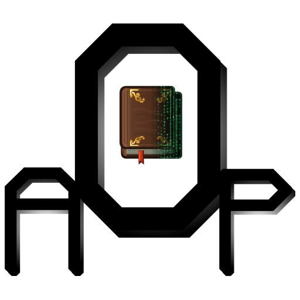

# AOP:TC4 Compact



Optional recipe and tooltip integration for **AOP: Thaumcraft 4**, targeting **Minecraft 1.21.1 / NeoForge**.

[Русский](README.ru.md) | [Attribution](NOTICE.md)

## Overview

AOP:TC4 Compact integrates Thaumcraft recipes with JEI and EMI, and block information with Jade and WTHIT. Thaumic Tinkerer device support activates when the addon is installed.

Recipe displays include research requirements, aspect quantities and vis costs. Unknown aspects remain masked according to configuration. Core block tooltips expose essentia through public container and transport contracts; Tinkerer tooltips include tablet tools, transvector targets, repair state and magnet modes.

## Compatibility

Java **21**, NeoForge **21.1.252 or newer within 21.1**, a compatible **AOP: Thaumcraft 4 1.0.0** build and **AOP: UI 0.7.x** are required. At least one supported integration is needed to display recipes or tooltips.

| Integration | Supported range | Purpose |
| --- | --- | --- |
| JEI | 19.8.4.110 ≤ version < 20 | Recipe viewer |
| EMI | 1.1.13 ≤ version < 1.2 | Recipe viewer |
| Jade | 15.10 ≤ version < 16 | Block tooltips |
| WTHIT | 12.5 ≤ version < 13 | Block tooltips |

All dependencies must target Minecraft 1.21.1 / NeoForge. If both recipe viewers are installed, EMI is selected. Jade and WTHIT integrations operate independently. Thaumic Tinkerer is optional.

## Installation

Install `aoptc4-compact-0.7.0.jar` in the client's `mods` directory alongside the core, AOP: UI and the selected viewers, including their dependencies.

Replace an existing `thaumcraft-viewers` JAR rather than installing both. The runtime ID remains `thaumcraft_viewers` to preserve configuration compatibility.

### Dedicated servers

Compact is optional on the server. Installing it alongside Jade or WTHIT provides authoritative block data. Without server installation, tooltips use synchronized state already available to the client; unsynchronized inventories may be unavailable.

AOP: UI is required wherever Compact is installed and is independently required by the core. JEI and EMI are not required on a dedicated server. Tinkerer remains optional on both sides.

## Configuration

Settings are stored in `thaumcraft_viewers-client.toml` and are available through AOP: UI from Mods, the Thaumonomicon gear or the pause menu. Client changes save immediately.

| Setting | Default | Alternative |
| --- | --- | --- |
| `recipes` | `ALL_WITH_REQUIREMENTS` | `RESEARCHED_ONLY` |
| `aspects` | `SCANNED_ONLY` | `ALL` |

Original configuration keys and defaults are retained. Display settings do not override server-side research or crafting checks.

## Building from source

The PowerShell wrapper also supports a local workspace: when the parent contains `.aop-workspace`, build outputs, caches and run profiles stay in that parent directory. Without the marker, the repository uses its normal `build/` and `runs/` directories. Gradle accepts `-PaopWorkspace=<directory>` for an explicit output location.

JDK 21 and compatible AOP: UI, Thaumcraft API and Tinkerer artifacts are required:

```powershell
$dependencies = @(
    '-PaopUiJar=C:/dependencies/aopui-1.21.1-0.7.0.jar'
    '-PthaumcraftApiJar=C:/dependencies/thaumcraft-api-1.0.0.jar'
    '-PtinkererJar=C:/dependencies/ThaumicTinkerer-1.21.1-1.0.0.jar'
)
./gradlew.ps1 build @dependencies
```

On Linux and macOS, use `sh ./gradlew` with the same Gradle properties. Dependencies may alternatively be placed in `libs/` under the filenames declared in `build.gradle`. Tinkerer is a compile-time dependency for its optional adapter; it is not a runtime requirement. Dependency classes are not bundled.

The gameplay artifact is `build/libs/aoptc4-compact-0.7.0.jar`.

## Verification

`build` runs recipe presentation and isolated JEI/EMI linkage checks, and compiles native tooltip verification sources. Viewer profiles are selected with `check -PviewerCompatibility=minimum`, `middle` or `latest`.

Native GameTests require the core runtime through `thaumcraftRuntimeJar` and the corresponding optional integration flags. Automated checks do not establish visual compatibility for every client/server combination.

Bug reports should include the core, Compact and viewer versions, reproduction steps and the relevant log.

## Continuous integration

In **Actions → Build and release → Run workflow**, enable **release** to publish an ordinary GitHub release with tag `v<version>`. Leave **version** blank to use `mod_version` from `gradle.properties`, or enter `major.minor.patch` to override it for that run. The selected version is used in the JAR metadata, filenames and tag; the workflow does not modify the source files. Prerelease suffixes are rejected in release mode. Existing release tags are never overwritten. Pushes to `main` and manual runs with **release** disabled update the single `nightly` prerelease. Nightly JAR versions use `<mod_version>-nightly.<run_number>`. Pull requests build artifacts without publishing. Local `act` runs never publish. Ordinary release notes list every commit since the nearest previous ordinary release on the selected history, with commit links and a comparison link. The first release includes the full history. Nightly notes omit this list.

For local `act` runs, place compatible dependency source checkouts at `.dependencies/aopui`, `.dependencies/thaumcraft`, `.dependencies/tinkerer` before running `act workflow_dispatch --input release=true`. Local runs use these checkouts and skip GitHub publication. For private dependency repositories, configure the optional `DEPENDENCY_TOKEN` secret with read access to those repositories.

The GitHub workflow runs for source and build changes. Documentation-only changes do not trigger a build.

| Repository variable | Purpose / default |
| --- | --- |
| `THAUMCRAFT_REPOSITORY` | Core source; `Salossov/aop-thaumcraft-4` |
| `THAUMCRAFT_REF` | Core revision; `main` |
| `TINKERER_REPOSITORY` | Tinkerer source; `Salossov/aoptc4-thaumic-tinkerer` |
| `TINKERER_REF` | Tinkerer revision; `main` |
| `AOPUI_REPOSITORY` | AOP: UI source; `Salossov/aop-ui` |
| `AOPUI_REF` | AOP: UI revision; `main` |

Compatible revisions must be selected for all dependencies. Private checkouts require a token with repository read access.

## Credits and terms

- [Salossov](https://github.com/Salossov) - integration and maintenance.
- [Azanor](https://www.curseforge.com/minecraft/mc-mods/thaumcraft) - Thaumcraft.
- [Vazkii](https://github.com/Vazkii/ThaumicTinkerer), pixlepix, nekosune and the original contributors - Thaumic Tinkerer.
- JEI, EMI, Jade and WTHIT projects - integration APIs.

[NOTICE.md](NOTICE.md) describes attribution and license scope. Dependencies and original assets retain their respective terms.
